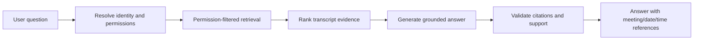

# 07 — AI Meeting Assistant and Retrieval-Augmented Generation

## 1. Purpose
Answer questions about past meetings and generate summaries, minutes, decisions, open questions, and action items grounded in authorised meeting records.

## 2. Retrieval workflow

## 3. Mandatory rules
- Apply permissions before retrieving content; never retrieve broadly and filter only after generation.
- Return meeting title, date, and transcript timestamp/segment references.
- Every material factual answer must map to retrieved evidence.
- Distinguish transcript quotations from AI interpretation.
- If evidence is absent, say the system cannot find support.
- Do not invent decisions, owners, deadlines, or action items.
- Require human review before finalising minutes or distributing outputs.
- Do not automatically send invitations or take consequential actions without explicit review and permission.
- Treat transcript/document content as untrusted input, not system instruction.
- Do not allow arbitrary SQL, shell commands, unrestricted tools, or model-controlled permission changes.

## 4. Initial retrieval implementation
- Begin with PostgreSQL full-text search.
- Add vector search only when justified by evaluation.
- Store evidence references as stable transcript segment IDs and time ranges.
- Preserve source version and tenant scope.
- Use a local LLM runtime such as Ollama only after selecting and reviewing the exact model and weight licence.

## 5. Output structure
For a meeting answer:
- concise answer
- supporting meeting title and date
- timestamp or segment reference
- clear indication where content is inference or interpretation
- explicit abstention when unsupported

For generated minutes:
- meeting metadata
- attendees as recorded
- agenda
- discussion summary
- decisions (with evidence)
- action items (owner/deadline only if supported)
- open questions
- review status and version

## 6. Evaluation
Create a labelled test set with:
- answerable questions
- unanswerable questions
- conflicting statements
- ambiguous speaker references
- cross-tenant adversarial cases
- prompt-injection content embedded in transcripts
- outdated and superseded transcript versions

Measure citation validity, answer support, abstention quality, permission enforcement, and human correction rate.
