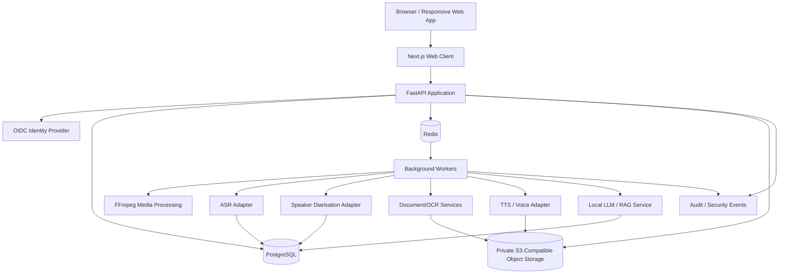

# 01 — System Architecture

## 1. Architecture principles
- Standalone enterprise product; support SaaS and private/on-premises editions.
- Begin with a modular monolith, separate worker processes, and model-serving adapters.
- Avoid premature microservices.
- Keep speech, language, document, and voice models behind stable server-side interfaces.
- Preserve source media and source documents; store derived artifacts separately.
- Enforce tenant isolation end-to-end.
- Use open/self-hosted models where technically and legally suitable; no compulsory per-minute external AI API.
- Hardware, power, storage, bandwidth, backup, engineering, and support remain real operating costs.

## 2. Logical component view

## 3. Recommended stack
| Layer | Candidate | Notes |
|---|---|---|
| Web client | Next.js, React, TypeScript | Responsive enterprise application |
| UI | Tailwind CSS, shadcn/ui | Accessible consistent components |
| API | Python FastAPI | Typed API and AI ecosystem |
| Database | PostgreSQL | Relational source of truth, full-text search, RLS |
| Jobs | Redis + Celery or Dramatiq | Long-running media/document/model jobs |
| Object storage | S3-compatible, e.g. MinIO | Private buckets and lifecycle |
| Identity | Keycloak or managed OIDC | MFA, SSO, identity lifecycle |
| ASR | Whisper / faster-whisper | Benchmark models/hardware |
| Diarisation | WhisperX plus separately licensed model or approved alternative | Verify all terms and access |
| Standard TTS | Kokoro for supported languages; evaluate CosyVoice | Language coverage varies |
| Voice cloning | OpenVoice V2 initial evaluation; CosyVoice alternative evaluation | Consent gate and model licence gate |
| Local LLM | Ollama or approved runtime | Weights have individual licences |
| DOCX | python-docx | Generation/editing |
| PDF | LibreOffice headless; ReportLab for controlled layouts | Visual regression required |
| Media | FFmpeg | Build/licence configuration review |
| Tests | pytest, Vitest, Playwright | Backend, UI, end-to-end |
| Observability | OpenTelemetry, Prometheus/Grafana, structured logs | Metrics and traces |

## 4. Service boundaries
- **Identity/Tenant:** identity claims, organisation membership, role/permission resolution.
- **Meeting:** meeting metadata, agenda, participants, notes, shares, comments.
- **Media:** upload sessions, chunks, source assets, derivatives, playback authorisation.
- **Transcription:** ASR jobs, transcript segments, speaker labels, revisions, exports.
- **Document:** ingest, OCR routing, extracted text, templates, exports.
- **Speech:** TTS projects, chunks, audio assets, chapters, pronunciation entries.
- **Voice Governance:** consent, verification, profiles, permissions, revocation, audit.
- **Assistant/Search:** permission-filtered retrieval, evidence references, generated insights.
- **Operations:** jobs, notifications, retention, legal holds, model registry, licence registry, audit.

## 5. Data flow rules
- Browser sends media to API-issued, short-lived upload authorisations; it never receives storage credentials.
- API creates durable job records and queues work.
- Workers process media outside web request lifecycles.
- Workers write output objects to private storage and metadata to PostgreSQL.
- API checks access before issuing short-lived signed URLs.
- AI retrieval applies permission filters before content reaches the model.
- Every generated output records model, version, configuration, and source references.

## 6. Deployment profiles
### Developer
Multi-core workstation, 16–32 GB RAM, SSD, optional supported GPU, Docker Compose, synthetic/test data.

### Pilot
Dedicated CPU/RAM, fast SSD, private object storage, bounded worker queues, optional GPU where required.

### Production SaaS
Separate web/API capacity, PostgreSQL HA strategy, Redis, object storage, GPU/CPU worker pool, monitoring, backups, disaster recovery, per-tenant quotas.

### Private/on-premises
Customer-owned compute, network segmentation, local identity option, encrypted storage, offline model distribution procedure, documented upgrade and backup path.

## 7. Capacity rule
Do not state concurrency or throughput guarantees before benchmarking on the actual hardware and selected models. Measure 30-minute, one-hour, and multi-hour files; real-time factor; queue wait; WER; diarisation error; TTS latency; storage growth; and per-tenant fairness.

## 8. Architecture quality attributes
- Availability and recoverability
- Tenant isolation
- Confidentiality and data minimisation
- Auditability and provenance
- Replaceable model providers
- Operational simplicity
- Portability between SaaS and private deployments
