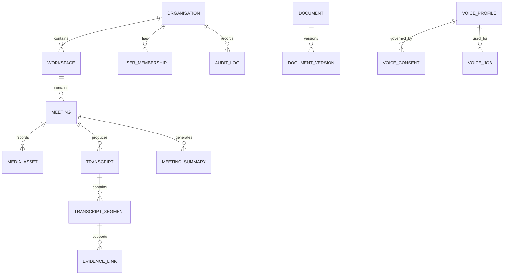

# 03 — Domain Model and Database Blueprint

## 1. General rules
- UUID primary keys.
- UTC timestamps; render in the user's selected timezone.
- Every tenant-owned entity has `organisation_id`.
- Add `workspace_id`, `department_id`, or `project_id` where needed.
- Tenant-leading indexes for common tenant queries.
- Foreign keys and restrictive deletion for audit-sensitive records.
- Store binaries in object storage, not PostgreSQL.
- Store object key, checksum, content type, size, encryption metadata, and retention metadata.
- Keep transcript revisions; never silently overwrite reviewed text.
- Separate AI outputs from human-authored source records.
- Record model ID/version, prompt/template version, and processing configuration.
- Define actual purge and backup expiry behaviour; soft-delete is not physical deletion.

## 2. Logical domains and entities

| Domain | Core entities |
|---|---|
| Tenant & identity | organisations, workspaces, departments, users/profiles, roles, permissions, user_roles, role_permissions, invitations, sessions, audit_logs |
| Meetings | meetings, meeting_participants, meeting_agendas, meeting_notes, meeting_shares, meeting_comments |
| Media | media_assets, media_chunks, media_upload_sessions, media_processing_jobs, media_derivatives |
| Transcription | transcripts, transcript_segments, transcript_speakers, speaker_labels, transcript_revisions, transcript_exports |
| AI insights | meeting_summaries, decisions, action_items, ai_questions, ai_answers, evidence_links, ai_job_logs |
| Documents | documents, document_versions, document_templates, document_exports, document_shares |
| Voice | voice_profiles, voice_samples, voice_consents, voice_permissions, voice_jobs, voice_audit_events |
| TTS/audio | speech_projects, speech_chunks, audio_assets, audio_chapters, pronunciation_entries |
| Operations | background_jobs, integration_events, notifications, retention_policies, legal_holds, deletion_requests, model_registry, licence_registry |

## 3. Key relationships

## 4. Voice profile fields
- `voice_profiles`: id, organisation_id, owner_user_id, display_name, status, model_id, model_version, consent_record_id, created_at, expires_at, revoked_at.
- `voice_samples`: id, voice_profile_id, object_key, duration_ms, checksum, source_type, consent_scope, retention_until.
- `voice_consents`: id, owner_user_id, consent_text_version, signed_at, verification_method, permitted_uses, jurisdiction, revocation_at.
- `voice_permissions`: voice_profile_id, grantee_user_id/role_id, allowed_use, expires_at, granted_by.
- `voice_jobs`: id, organisation_id, requester_id, voice_profile_id, text_hash, output_object_key, disclosure_flag, status, created_at.
- `voice_audit_events`: actor_id, action, voice_profile_id, job_id, result, timestamp, permitted IP/device metadata.

## 5. Job records
Every long-running job must include:
- ID, organisation ID, job type, source object/entity, status
- progress and safe user-facing status
- retry count and maximum retries
- idempotency key
- worker/model version
- created, started, completed, and updated timestamps
- safe error code/message (no secrets or sensitive transcript content)
- cancellation state and tenant-aware priority

Statuses: `queued`, `running`, `succeeded`, `failed`, `cancelled`.

## 6. Database security & PostgreSQL RLS contract
- Use PostgreSQL Row-Level Security (RLS) on all tenant-owned tables (`ENABLE ROW LEVEL SECURITY` and `FORCE ROW LEVEL SECURITY`).
- Set tenant and actor context safely within each database transaction using:
  - `SET LOCAL app.current_organisation_id = '<verified_org_uuid>';`
  - `SET LOCAL app.current_user_id = '<verified_user_uuid>';`
- Standard tenant isolation policy expression:
  - `USING (organisation_id = NULLIF(current_setting('app.current_organisation_id', true), '')::uuid)`
  - `WITH CHECK (organisation_id = NULLIF(current_setting('app.current_organisation_id', true), '')::uuid)`
- Do not trust client-supplied `organisation_id`.
- Derive tenant context from authenticated Supabase Auth identity and verified server-side `user_roles` membership.
- Add tests for direct SQL/API access, guessed IDs, search, jobs, and object storage.
- Ensure background workers establish tenant context explicitly before executing job logic.
- Maintain a tamper-evident per-organisation `SHA-256` hash chain (`previous_hash`, `entry_hash`) on `audit_logs`.

## 7. Retention and deletion
Retention policy must be configurable by tenant and record class. Legal holds override routine deletion only when properly authorised and recorded. Deletion requests must track requested scope, approval, processing, object purge, derivative purge, backup expiry, exceptions, and completion evidence. Do not claim immediate erasure from backups unless the actual backup lifecycle supports it.
